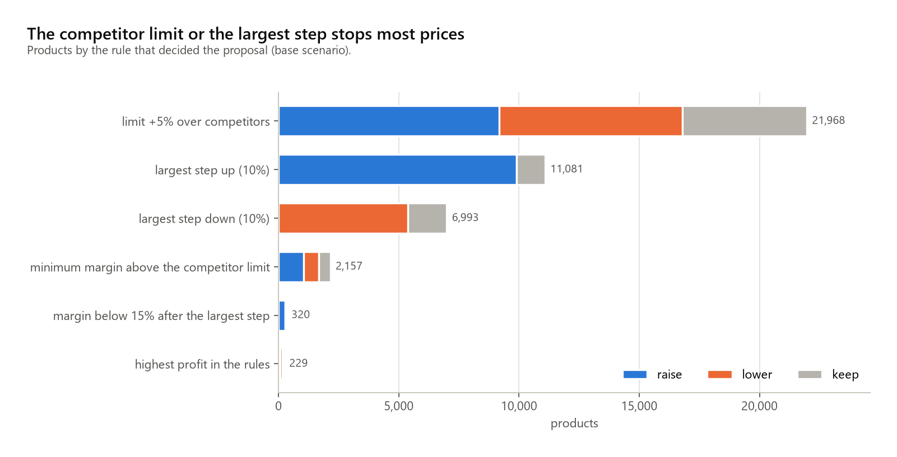
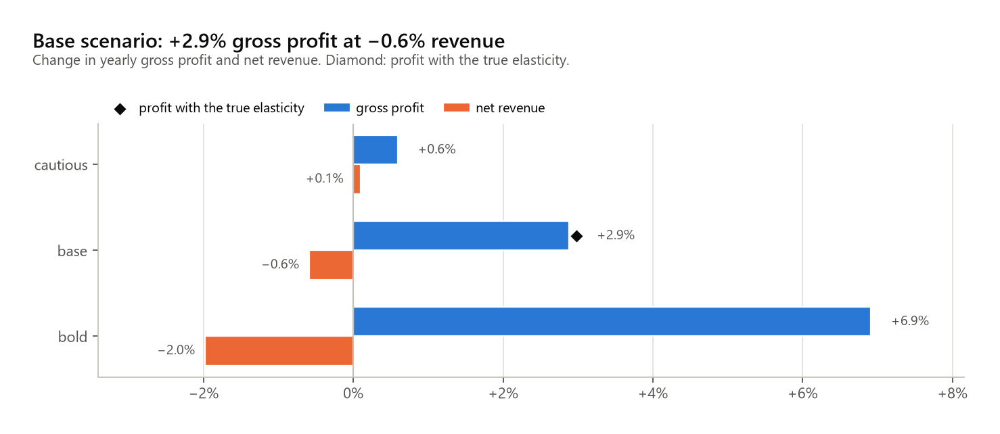
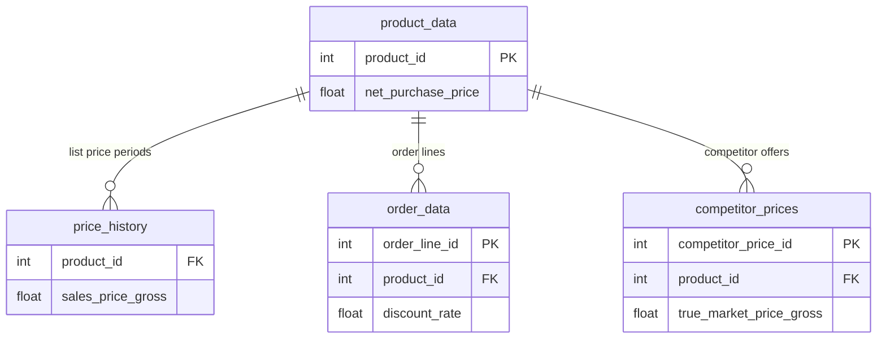

# Pricing Engine

[](https://github.com/tlabedzki/Pricing-Engine/actions/workflows/tests.yml)


[](https://github.com/tlabedzki/Pricing-Engine/releases)

A price proposal engine for a fictional online shop: a new price for every product, a one-sentence reason and a profit
estimate, checked against an answer key.

**Problem.** A shop sells tens of thousands of products, and most prices were set once with a markup. It does not know
where a price is too low and gives away profit, or too high and sends customers to competitors. A cut "just in case"
eats the margin, and a rise without the numbers can eat the sales.

**Approach.** From price history and sales, the project estimates how strongly demand reacts to price in each category
(price elasticity). Then, within the rules (a minimum margin, a limit over the competitors, a largest step), it picks
the price with the highest expected profit. The data come with an answer key, so the result can be checked.

<!-- generated:result -->
**Result.** The engine checks the prices of 42,748 products and changes 34,190; in the base scenario yearly gross profit
grows by +2.9% while net revenue changes by −0.6%. The same prices judged with the true elasticity give +3.0%, and the
elasticity estimate hits the truth in 12 of 15 categories.
<!-- /generated:result -->

<!-- generated:hero -->
<picture>
  <source media="(prefers-color-scheme: dark)" srcset="docs/img/app-demo-dark.svg">
  
</picture>
<!-- /generated:hero -->

**Stack:** Python · pandas · DuckDB · SQL · SciPy · matplotlib · Streamlit · pytest

<!-- generated:summary -->
- **What worked:** the profit predicted from the data (+2.9%) is 0.1 points from the profit with the true elasticity
  (+3.0%); discounts and list-price changes together give a mean elasticity error of 0.12.
- **What missed:** in 3 categories the truth lies outside the estimate's interval: Health (0.47 vs 0.60), Books & Media
  (0.85 vs 1.00), Electronics (1.83 vs 1.60); 22% of products stay above the competitor limit, because one step is not
  enough or the minimum margin does not allow it.
<!-- /generated:summary -->

## 1. The situation: Lumo and its prices

Lumo is a fictional Polish online shop with 15 categories, from clothing to furniture. It has two years of orders, a
history of list prices and the prices of five fictional competitors. The category manager wants to know which prices
to change, by how much and what happens next.

| Question | Method and tables | Answer to check against |
|---|---|---|
| How strongly does demand react to price in each category? | Elasticity from list-price changes and discounts on `price_history` and `order_data` (chapter 3) | `category_price_elasticity` in the generator settings |
| Where is our price out of line with the competitors? | Price index from `competitor_prices` (chapter 4) | `true_market_price_gross`, `true_price_level` |
| Which price should each product get? | Rule engine with a profit calculation (chapter 4) | profit of the same prices with the true elasticity (chapter 5) |
| How much profit do we gain, and how much revenue do we lose? | A year simulated in three scenarios (chapter 5) | as above |
| How far can we trust the result? | Interval from drawing the elasticity (chapter 5) | the interval against the truth (chapter 7) |

## 2. How we know the truth

The data come from [Data-Generator](https://github.com/tlabedzki/Data-Generator) v1.6.0 (seed 42), which sets how
customers react to price. Those settings are the answer key:

- `category_price_elasticity`: price elasticity in a category, how many percent sales fall after a 1% price rise (1.8
  in clothing, 0.6 in health, 1.2 wherever no other value is set);
- `true_market_price_gross`: the market price of a product, from which the competitors set theirs;
- `true_price_level`: a competitor's price level against the market (the discounter 0.92, the premium shop 1.08).

The engine never reads them. It estimates the elasticity from what a real shop sees: orders, price history and
competitor prices. Only the grading opens the key: it compares the estimate with the truth and recalculates the
profit of the same proposals with the true elasticity. A real shop cannot run this check, because it does not know its
elasticity.

In the generator, competitor prices do not affect demand. The competitor limit is therefore a business rule, not a
result from the data (more in chapter 8).

## 3. How strongly does demand react to price?

**Question.** How much do a category's sales fall when the price goes up by 1%?

**What we did.** Two signals in the data carry the elasticity. The first is list-price changes: after a rise, a
product gets a smaller share of its category's orders. The model compares price periods of the same product (a
conditional Poisson model for the number of orders), so the product's popularity does not change the result. Each
period counts by the category's traffic on its days (an SQL query in DuckDB). The second signal is discounts: a
discounted order line has more units. The two estimates are averaged by their precision, and categories with few
sales are pulled towards the average of all categories (empirical Bayes).

**How we check it.** Every estimate has a 90% interval (the range that should hold the truth 9 times out of 10). A
hit is the truth inside the interval.

**Result.**

<!-- generated:elasticity -->
List-price changes alone miss by 0.45 on average, discounts alone by 0.13, and both combined and pulled towards the
average by 0.12. The true value lies in the 90% interval in 12 of 15 categories.


In red, the categories whose truth falls outside the interval: Health (0.47 vs 0.60), Books & Media (0.85 vs 1.00),
Electronics (1.83 vs 1.60).
<!-- /generated:elasticity -->

**What it means for the shop.** Price history alone is not enough: prices change rarely, and most products sell a few
times a year. Discounts carry a much stronger signal, so the engine leans on them.

## 4. Which price should each product get?

**Question.** Which price earns more without drifting away from the competitors?

**What we did.** A price index measures a product's position in the market: our price divided by the median competitor
price (1.05 means 5% dearer). A competitor's promotion of a few days counts at its price before the promotion. For
every product on sale, the engine tries prices ending in 9 within ±30% of today's. It drops those that break the
rules: a net margin of at least 15% after the average discount, at most 5% over the median competitor price and at most
a 10% change at once. From the rest it picks the price with the highest expected gross profit, with demand at the new
price from the category elasticity. Each proposal records the rule that stopped the price and a reason, for example
"Raise 9.6%, as far as the 10% step limit allows: 13% below the competitor median, demand in Electronics reacts
strongly to price (elasticity 1.8)".

**How we check it.** Tests make sure that no proposal breaks the rules. The one exception is a conflict: when the
minimum margin needs a price above the competitor limit, the margin wins, and the reason says so.

**Result.**

<!-- generated:proposals -->
Of 42,748 products on sale the engine raises 20,475 prices, lowers 13,715 and keeps 8,558. Within +5% of the competitor
median today: 62% of products with a competitor offer, after the changes 78%.


The competitor limit or the largest step decides 40,042 proposals (94%), a margin-versus-market conflict 2,477, and the
profit calculation alone only 229.


<!-- /generated:proposals -->

**What it means for the shop.** With Lumo's elasticities (0.5 to 1.8), the most profitable price is usually above
today's, so the rules decide how far to go. Some products sit so far from the market that reaching the limit takes
several rounds of changes.

## 5. What does it do to a year of sales?

**Question.** How do yearly gross profit, revenue and units sold change?

**What we did.** The starting point is each product's sales in the last 12 months. A product that sold only a few times
gets its category's average mixed in. The engine recalculates sales at the new prices in three scenarios of rules. The
cautious one assumes demand more sensitive to price: the elasticity raised by 1.64 standard errors (a measure of the
estimate's uncertainty), the upper end of the 90% interval. Finally, the engine draws the elasticity from its
intervals 1,000 times to show how uncertain the result is.

**How we check it.** We recalculate the same proposals with the true elasticity from Data-Generator and compare the
profit.

**Result.**

<!-- generated:scenarios -->
| Scenario | Rules | Gross profit | Net revenue | Units | Raised / lowered |
|---|---|---|---|---|---|
| cautious | up to the competitor median, 5% steps, demand 1.64 SE more sensitive | +0.6% | +0.1% | +0.6% | 13,179 / 15,713 |
| base | +5% over the median, 10% steps | +2.9% | −0.6% | −0.2% | 20,475 / 13,715 |
| bold | +10% over the median, 15% steps | +6.9% | −2.0% | −3.2% | 26,517 / 10,047 |



Drawing the elasticity from its intervals, the base profit change stays between +2.8% and +3.0% in 90% of draws.
Electronics gains the most; Books & Media loses.


<!-- /generated:scenarios -->

**What it means for the shop.** The base scenario raises profit with almost no loss of sales. The bold one earns more,
but at the cost of revenue and prices clearly above the competitors. Low-margin categories such as electronics gain
the most: there, every zloty of a rise is a large part of the margin. Categories lose where cuts down to the
competitor limit cost more than the extra sales bring.

## 6. The app: rules on sliders

The Streamlit app shows the engine at work (the animation at the top of the page). On the left are the rule sliders:
minimum margin, the limit over the competitor median, the largest step and caution, the number of standard errors
added to the elasticity (as in the cautious scenario). Every change recalculates yearly profit, revenue, units and the
profit with the true elasticity. The "Proposals" tab lists the proposals with their reasons and a CSV download,
"Categories" shows the profit change per category and the rules that decided, and "Elasticity" puts the estimate next
to the truth.


## 7. Analysis against the truth

<!-- generated:verdicts -->
The elasticity hits the truth in 12 of 15 categories, and the base profit predicted from the data (+2.9%) matches the
profit with the true elasticity (+3.0%).

| Question | Answer from the data | Truth | Verdict |
|---|---|---|---|
| Elasticity: Health | 0.47 [0.36, 0.59] | 0.60 | miss |
| Elasticity: Books & Media | 0.85 [0.74, 0.96] | 1.00 | miss |
| Elasticity: Electronics | 1.83 [1.63, 2.03] | 1.60 | miss |
| Elasticity: Clothing | 1.81 [1.76, 1.87] | 1.80 | hit |
| Elasticity: Beauty | 1.20 [1.07, 1.33] | 1.20 | hit |
| Other 10 categories | inside the interval | see the chart in chapter 3 | hit |
| Profit change, base scenario | +2.9% [+2.8%, +3.0%] | +3.0% | miss, outside the interval |
| Revenue change, base scenario | −0.6% | −0.4% | 0.2 points apart |
<!-- /generated:verdicts -->

**Where it went wrong and what it teaches.**

- **Health and Books: the list-price signal underestimates the elasticity.** On its own, that signal puts Health
  close to zero. The model simplifies the generator: it weighs category traffic by product popularity, while the
  generator also picks products by brand and by the customer's price level. Lesson: one signal can be biased, so it
  helps to have two independent ones.
- **Electronics: the estimate is too high.** The category has few orders per product, and pulling towards the average
  was not enough. The engine is therefore more careful with electronics rises than it needs to be.
- **The profit interval is too narrow.** Drawing the elasticity covers only the random error of the estimate, not its
  bias in three categories, so the truth falls just outside the interval. Lesson: an interval from the model is a
  lower bound on the uncertainty, not all of it.

The misses stay in the table on purpose: a grading that can say "miss" makes each "hit" worth something. In a real shop
nobody would see these misses, because there is no answer key.

## 8. Takeaways and limitations

**Recommendations.**

1. Roll out the base scenario: profit goes up at almost the same revenue, and the true elasticity confirms the
   calculation.
2. Change prices in rounds. After one round some products stay above the competitor limit, because reaching it takes
   several steps.
3. Estimate the elasticity from discounts and list-price changes together. The list-price signal alone misses several
   times more.
4. Where the minimum margin needs a price above the market, check the purchase cost or the offer. The engine cannot
   reach the competitor limit there.

**Limitations.**

- The data are synthetic, with one elasticity per category that does not change over time. In a real shop it differs
  between products and seasons, and a discount may work differently from a list-price change.
- Competitor prices do not affect demand in the generator, so the model does not see the cost of a price above the
  market. The competitor limit guards against it as a rule. In a real shop it is worth replacing with an estimate from
  market share data.
- One seed and a one-year projection. The result leaves out competitors' reactions to our changes and returns.
- Without an answer key, an A/B price test on part of the products checks the elasticity.

## Quickstart

You need Git and Python 3.11. Clone the repository:

```bash
git clone https://github.com/tlabedzki/Pricing-Engine.git
cd Pricing-Engine
```

<details><summary>Create and activate a virtual environment with Python 3.11 (Windows, macOS and Linux)</summary>

Naming the version picks Python 3.11 even if another one is the default.

| Step | Windows (PowerShell) | macOS and Linux |
|---|---|---|
| Create | `py -3.11 -m venv .venv` | `python3.11 -m venv .venv` |
| Activate | `.venv\Scripts\Activate.ps1` | `source .venv/bin/activate` |
| Check | `python --version` prints `Python 3.11.x` | `python --version` prints `Python 3.11.x` |

If PowerShell says that running scripts is disabled, run `Set-ExecutionPolicy -Scope CurrentUser RemoteSigned` once
and activate again.

</details>

Then install the packages, get the data and run the engine:

```bash
pip install -r requirements.txt
python scripts/get_data.py
python main.py
```

`get_data.py` clones Data-Generator v1.6.0 and generates the shop data (about 15 s). `main.py` prints the elasticity,
sample proposals and the scenarios, and saves CSV files and `summary.json` to `output/` (about 15 s).

### Command line

`python main.py propose --min-margin 0.2 --max-above-market 0 --max-step 0.05` computes proposals with your own rules.
`python main.py elasticity` shows the elasticity estimate next to the truth.

### App

`streamlit run app/streamlit_app.py` opens the app at http://127.0.0.1:8501 (this computer only). The first load takes
a few seconds; Ctrl+C in the terminal stops it.

## Data

The data are synthetic: [Data-Generator](https://github.com/tlabedzki/Data-Generator) v1.6.0 (MIT license), seed 42,
generated by `scripts/get_data.py` into `data/raw/` (outside git). The engine reads four of its 15 tables. Product
brands are real, but the products, prices, margins and sales are fictional and say nothing about those brands. The
competitor shops (Frugalia, Aequo, Maison Orvelle, Mercatoria, Fulmina) are fictional.



Column descriptions:
[docs/columns.md in Data-Generator](https://github.com/tlabedzki/Data-Generator/blob/v1.6.0/docs/columns.md).
The true elasticity goes to `data/raw/truth.json` straight from the generator settings.

## Project structure

<details><summary>Show the tree</summary>

```
main.py                         command line: elasticity, proposals, scenarios
src/pricing_engine/
  data.py                       loads the Data-Generator tables
  sql/price_periods.sql         DuckDB query: order lines and exposure per list-price period
  elasticity.py                 elasticity from list prices and discounts, combined and shrunk
  engine.py                     rules, profit-optimal prices ending in 9, reasons
  simulate.py                   scenarios, uncertainty, check with the true elasticity
  report.py                     the five headline numbers shown in the app and the animation
  mock_competitors.py           competitor table for tests and releases before v1.5.0
app/streamlit_app.py            the app
notebooks/01-pricing-engine.ipynb   the whole project step by step
scripts/get_data.py             clones and runs Data-Generator
scripts/make_charts.py          README charts and numbers (readme_blocks.py)
scripts/make_demo_svg.py        the animated app demo at the top (called by make_charts.py)
scripts/screenshot_app.py       app screenshot for the README
tests/                          pytest
```

</details>

## Tests

```bash
pip install -r requirements-dev.txt
python -m pytest
```

50 tests (about 20 s) check the estimators on data with a known elasticity, the engine's rules on random products, the
simulation, the competitor table, the command line and the app. The app test needs the data from `get_data.py`;
without them it is skipped, as in CI.

## License

MIT, see [LICENSE](LICENSE). [Changelog](CHANGELOG.md).

README last updated: 2026-11-24
