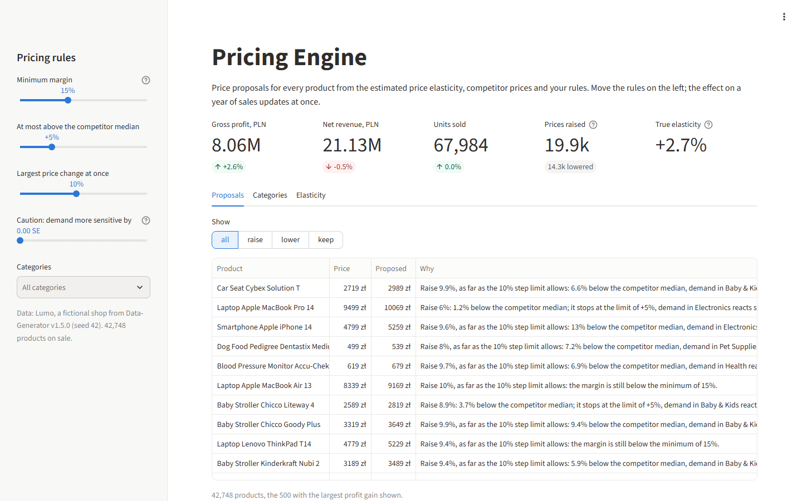
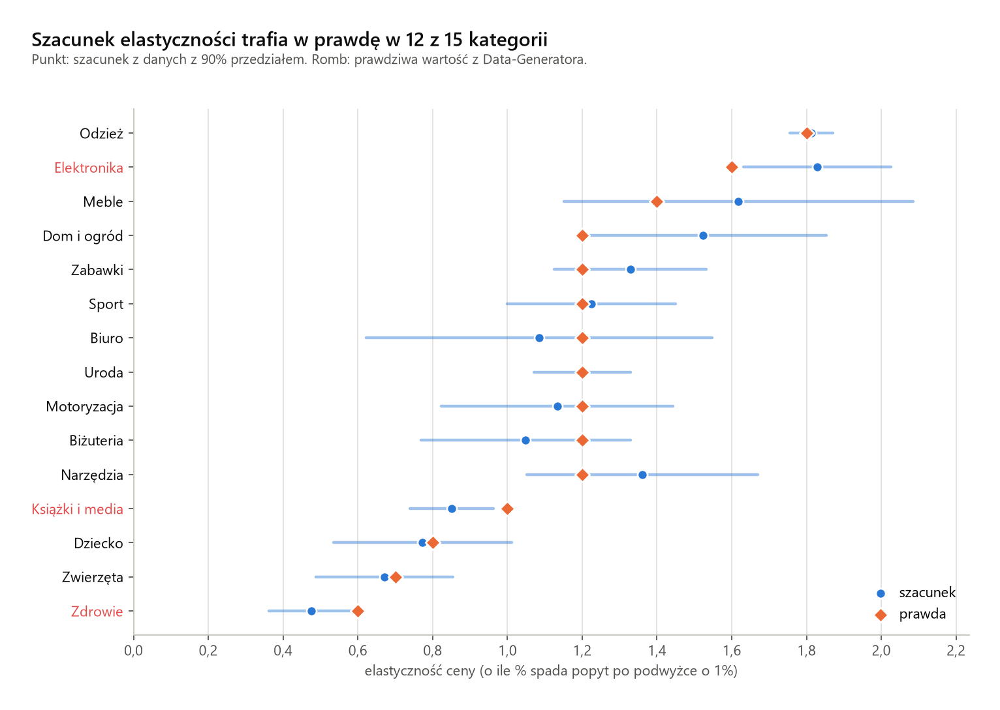
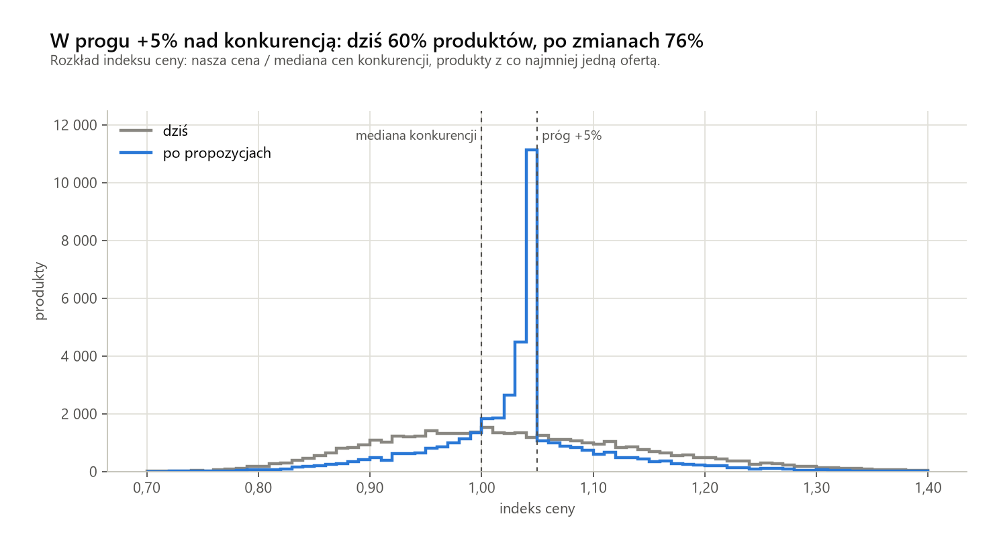
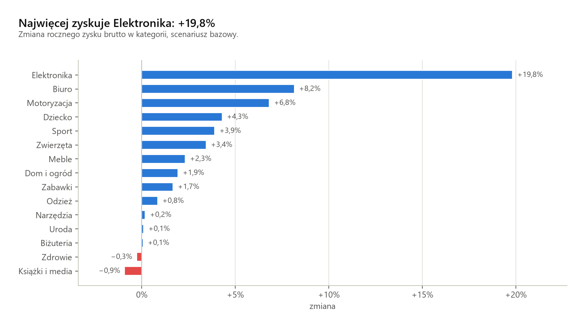
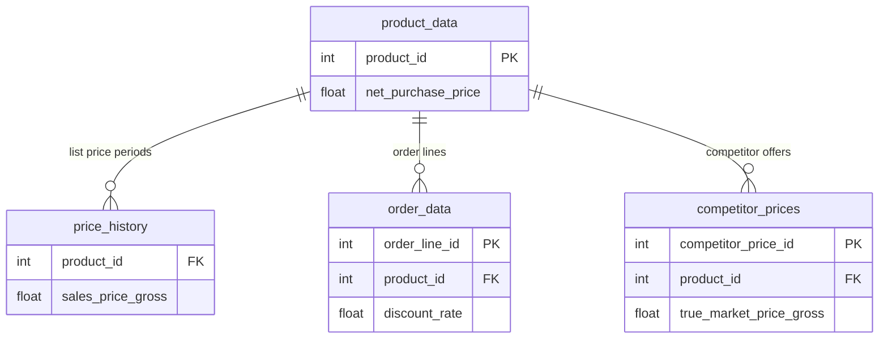

# Pricing Engine

[](https://github.com/tlabedzki/Pricing-Engine/actions/workflows/tests.yml)


[](https://github.com/tlabedzki/Pricing-Engine/releases)

Silnik propozycji cen dla fikcyjnego sklepu internetowego: nowa cena każdego produktu z powodem zapisanym zdaniem
i rachunkiem zysku, sprawdzonym z kluczem odpowiedzi.

**Problem.** Sklep ma dziesiątki tysięcy produktów i ceny ustawione raz, „z marżą”. Nie wie, gdzie cena jest za
niska i oddaje zysk, a gdzie za wysoka i traci klientów na rzecz konkurencji. Obniżka „na wszelki wypadek” zjada
marżę, a podwyżka bez rachunku może zjeść sprzedaż.

**Podejście.** Z historii cen i sprzedaży projekt szacuje, jak mocno popyt reaguje na cenę w każdej kategorii.
Potem w granicach reguł (minimalna marża, próg względem konkurencji, maksymalny krok) wybiera cenę o najwyższym
oczekiwanym zysku. Dane mają klucz odpowiedzi, więc wynik da się sprawdzić.

<!-- generated:result -->
**Wynik.** Silnik proponuje nową cenę dla 42 748 produktów; w scenariuszu bazowym roczny zysk brutto rośnie o +2,6% przy
−0,5% obrotu. Przeliczenie tych samych cen z prawdziwą elastycznością daje +2,7%, a szacunek elastyczności trafia w
prawdę w 12 z 15 kategorii.
<!-- /generated:result -->



**Stack:** Python · pandas · DuckDB · SQL · SciPy · matplotlib · Streamlit · pytest

<!-- generated:summary -->
- **Trafione:** zysk przewidziany z danych (+2,6%) różni się od zysku przy prawdziwej elastyczności (+2,7%) o 0,1 pkt
  proc.; rabaty i zmiany cen razem dają średni błąd elastyczności 0,12.
- **Chybione:** w 3 kategoriach prawda leży poza 90% przedziałem: Zdrowie (0,47 zamiast 0,60), Książki i media (0,85
  zamiast 1,00), Elektronika (1,83 zamiast 1,60); 24% produktów zostaje ponad progiem konkurencji, bo jeden krok to za
  mało albo nie pozwala na to minimalna marża.
<!-- /generated:summary -->

## 1. Sklep Lumo i pytanie o ceny

Lumo to fikcyjny polski sklep internetowy z 15 kategoriami, od odzieży po meble. Ma dwa lata zamówień, historię
cen katalogowych i ceny czterech fikcyjnych konkurentów. Kierownik kategorii chce wiedzieć, które ceny zmienić,
o ile i co z tego wyniknie.

| Pytanie | Jak odpowiada analiza | Gdzie leży prawdziwa odpowiedź |
|---|---|---|
| Jak mocno popyt reaguje na cenę w każdej kategorii? | Elastyczność ze zmian cen i rabatów na `price_history` i `order_data` (rozdział 3) | `category_price_elasticity` w ustawieniach generatora |
| Gdzie nasza cena odstaje od konkurencji? | Indeks ceny z `competitor_prices` (rozdział 4) | `true_market_price_gross`, `true_price_level` |
| Jaką cenę ustawić każdemu produktowi? | Silnik reguł z rachunkiem zysku (rozdział 4) | zysk tych samych cen przy prawdziwej elastyczności (rozdział 5) |
| Ile zarobimy, a ile stracimy obrotu? | Symulacja roku w trzech scenariuszach (rozdział 5) | jak wyżej |
| Na ile można ufać wynikowi? | Przedział z losowania elastyczności (rozdział 5) | porównanie przedziału z prawdą (rozdział 7) |

## 2. Skąd wiadomo, co jest prawdą

Dane pochodzą z [Data-Generatora](https://github.com/tlabedzki/Data-Generator) v1.5.0 (ziarno 42), który sam
ustawia, jak klienci reagują na cenę. Te ustawienia to klucz odpowiedzi:

- `category_price_elasticity`: elastyczność ceny w kategorii, czyli o ile procent spada sprzedaż po podwyżce
  o 1% (1,8 w odzieży, 0,6 w zdrowiu, 1,2 tam, gdzie nie ustawiono inaczej);
- `true_market_price_gross`: cena rynkowa produktu, od której liczą swoje ceny konkurenci;
- `true_price_level`: poziom cen konkurenta względem rynku (tańszy dyskont 0,92, sklep premium 1,08).

Silnik ich nie czyta. Szacuje elastyczność z tego, co widzi prawdziwy sklep: zamówień, historii cen i cen
konkurencji. Klucz otwiera dopiero ocena. Porównuje szacunek z prawdą i przelicza zysk tych samych propozycji
z prawdziwą elastycznością. Prawdziwy sklep takiego sprawdzenia nie ma, bo nie zna swojej elastyczności.

W generatorze ceny konkurencji nie wpływają na popyt. Próg względem konkurencji jest więc regułą biznesową, a nie
wynikiem z danych (więcej w rozdziale 8).

## 3. Jak mocno popyt reaguje na cenę?

**Pytanie.** O ile spadnie sprzedaż w kategorii, gdy cena wzrośnie o 1%?

**Co robi analiza.** Elastyczność niesie w danych dwa sygnały. Pierwszy to zmiany cen katalogowych: po podwyżce
produkt dostaje mniejszą część zamówień kategorii. Model porównuje okresy cen tego samego produktu (warunkowy
model Poissona dla liczby zamówień), więc popularność produktu się skraca. Okresy waży ruchem w kategorii
(zapytanie SQL w DuckDB). Drugi sygnał to rabaty: linia zamówienia z rabatem ma więcej sztuk. Oba szacunki łączy
średnia ważona ich dokładnością, a kategorie z małą sprzedażą są przyciągane do średniej wszystkich kategorii
(empiryczny Bayes).

**Jak to sprawdzamy.** Każdy szacunek ma 90% przedział (zakres, w którym prawda powinna leżeć w 9 przypadkach
na 10). Trafienie to prawda w przedziale.

**Wynik.**

<!-- generated:elasticity -->
Sam sygnał ze zmian cen katalogowych myli się średnio o 0,45, sam sygnał z rabatów o 0,13, a połączenie z przyciąganiem
do średniej o 0,12. Prawdziwa wartość leży w 90% przedziale w 12 z 15 kategorii.



Na czerwono kategorie, w których prawda wypada poza przedziałem: Zdrowie (0,47 zamiast 0,60), Książki i media (0,85
zamiast 1,00), Elektronika (1,83 zamiast 1,60).
<!-- /generated:elasticity -->

**Co to znaczy dla sklepu.** Sama historia cen to za mało, bo ceny zmieniają się rzadko, a większość produktów
sprzedaje się kilka razy w roku. Rabaty niosą znacznie mocniejszy sygnał, więc silnik opiera się głównie na nich.

## 4. Jaką cenę zaproponować każdemu produktowi?

**Pytanie.** Którą cenę ustawić, żeby zarobić więcej i nie odjechać od konkurencji?

**Co robi analiza.** Dla każdego produktu w sprzedaży silnik sprawdza ceny kończące się na 9 w zakresie ±30%
od dzisiejszej. Odrzuca te, które łamią reguły: marża netto po średnim rabacie co najmniej 15%, najwyżej 5%
nad medianą cen konkurencji i najwyżej 10% zmiany naraz. Z pozostałych wybiera cenę o najwyższym oczekiwanym
zysku brutto. Popyt przy nowej cenie liczy z elastyczności kategorii. Do propozycji dopisuje regułę, która
zatrzymała cenę, i powód zdaniem, np. „Raise 9.6%, the largest step allowed (10%): 13% below the competitor
median, demand in Electronics reacts strongly to price (elasticity 1.8)”.

**Jak to sprawdzamy.** Testy sprawdzają, że żadna propozycja nie łamie reguł. Wyjątek to konflikt: gdy minimalna
marża wymaga ceny ponad progiem konkurencji, wygrywa marża, a powód to mówi.

**Wynik.**

<!-- generated:proposals -->
Na 42 748 produktów w sprzedaży silnik podnosi 19 867 cen, obniża 14 285 i zostawia 8 596. W progu +5% nad medianą
konkurencji mieści się dziś 60% produktów z ofertą konkurencji, po zmianach 76%.



O 37 942 propozycjach (89%) decyduje próg konkurencji albo maksymalny krok, o 4 557 konflikt marży z rynkiem, a tylko o
249 sam rachunek zysku.


<!-- /generated:proposals -->

**Co to znaczy dla sklepu.** Przy elastyczności Lumo (0,5–1,8) cena o najwyższym zysku leży zwykle wyżej niż
dzisiejsza, więc o tym, jak daleko pójść, decydują reguły. Część produktów jest tak daleko od rynku, że dojście
do progu wymaga kilku rund zmian.

## 5. Ile to da w ciągu roku?

**Pytanie.** O ile zmieni się roczny zysk brutto, obrót i liczba sprzedanych sztuk?

**Co robi analiza.** Sprzedaż produktu z ostatnich 12 miesięcy, uśredniona ze średnią kategorii dla produktów
z małą sprzedażą, to punkt wyjścia. Silnik przelicza ją na nowe ceny w trzech scenariuszach reguł. Potem losuje
elastyczność z jej przedziałów 1000 razy, żeby pokazać, jak niepewny jest wynik.

**Jak to sprawdzamy.** Te same propozycje przeliczamy z prawdziwą elastycznością z Data-Generatora i porównujemy
zysk.

**Wynik.**

<!-- generated:scenarios -->
| Scenariusz | Reguły | Zysk brutto | Obrót netto | Sztuki | Podwyżki / obniżki |
|---|---|---|---|---|---|
| ostrożny | do mediany konkurencji, krok 5%, popyt czulszy o 1,64 błędu | +0,5% | +0,1% | +0,7% | 12 840 / 16 092 |
| bazowy | +5% nad medianą, krok 10% | +2,6% | −0,5% | 0,0% | 19 867 / 14 285 |
| odważny | +10% nad medianą, krok 15% | +6,5% | −1,8% | −2,8% | 25 844 / 10 691 |


Przy losowaniu elastyczności z jej przedziałów zmiana zysku w scenariuszu bazowym mieści się w 90% przypadków między
+2,5% a +2,7%. Najwięcej zyskuje Elektronika, tracą Książki i media oraz Zdrowie.


<!-- /generated:scenarios -->

**Co to znaczy dla sklepu.** Scenariusz bazowy podnosi zysk prawie bez utraty sprzedaży. Odważny zarabia więcej, ale
kosztem obrotu i ceny wyraźnie wyższej od konkurencji. Najwięcej zyskują kategorie z niską marżą, jak elektronika: tam
każda złotówka podwyżki to duża część marży. Tracą kategorie, w których obniżki do progu konkurencji kosztują więcej,
niż daje dodatkowa sprzedaż.

## 6. Aplikacja: reguły na suwakach

Aplikacja Streamlit pokazuje silnik w działaniu (zrzut na górze strony). Z lewej są suwaki reguł: minimalna marża,
próg nad medianą konkurencji, maksymalny krok i ostrożność, czyli o ile błędów standardowych przyjąć popyt bardziej
wrażliwy na cenę. Po każdej zmianie przelicza się roczny zysk, obrót, sztuki i zysk przy prawdziwej elastyczności.
Zakładka „Proposals” to lista propozycji z powodem i pobieraniem CSV, „Categories” to zmiana zysku w kategoriach
i reguły, które zdecydowały, a „Elasticity” to szacunek obok prawdy.

## 7. Analiza kontra prawda

<!-- generated:verdicts -->
Elastyczność trafia w prawdę w 12 z 15 kategorii, a zysk scenariusza bazowego przewidziany z danych (+2,6%) zgadza się z
zyskiem przy prawdziwej elastyczności (+2,7%).

| Pytanie | Odpowiedź z danych | Prawda | Ocena |
|---|---|---|---|
| Elastyczność: Uroda | 1,20 [1,07; 1,33] | 1,20 | trafione |
| Elastyczność: Książki i media | 0,85 [0,74; 0,96] | 1,00 | chybione |
| Elastyczność: Odzież | 1,81 [1,76; 1,87] | 1,80 | trafione |
| Elastyczność: Elektronika | 1,83 [1,63; 2,03] | 1,60 | chybione |
| Elastyczność: Zdrowie | 0,47 [0,36; 0,59] | 0,60 | chybione |
| Pozostałe 10 kategorii | w przedziale | – | trafione |
| Zmiana zysku, scenariusz bazowy | +2,6% [+2,5%; +2,7%] | +2,7% | chybione, poza przedziałem |
| Zmiana obrotu, scenariusz bazowy | −0,5% | −0,3% | różnica 0,2 pkt proc. |
<!-- /generated:verdicts -->

**Gdzie metody się pomyliły i czego to uczy.**

- **Zdrowie i Książki: sygnał ze zmian cen katalogowych zaniża elastyczność.** Sam ten sygnał daje w Zdrowiu
  wynik bliski zera. Model upraszcza mechanizm generatora: ruch w kategorii waży popularnością produktów, a generator
  dobiera produkty jeszcze według marki i poziomu cen klienta. Lekcja: jeden sygnał może być przesunięty, dobrze mieć
  dwa niezależne.
- **Elektronika: szacunek za wysoki.** Kategoria ma mało zamówień na produkt, a przyciąganie do średniej nie
  wystarczyło. Silnik jest przez to ostrożniejszy z podwyżkami elektroniki, niż musiałby być.
- **Przedział zysku za wąski.** Losowanie elastyczności obejmuje tylko przypadkowy błąd szacunku, a nie jego
  przesunięcie w trzech kategoriach, więc prawda wypada tuż za przedziałem. Lekcja: przedział z modelu to dolna
  granica niepewności, nie pełna.

Pomyłki pokazane wprost to atut projektu. Ocena może powiedzieć „chybione”, więc „trafione” coś znaczy. W
prawdziwym sklepie tych pomyłek nikt by nie zobaczył, bo nie ma klucza odpowiedzi.

## 8. Wnioski i ograniczenia

**Rekomendacje.**

1. Wdrożyć scenariusz bazowy: zysk rośnie przy prawie tym samym obrocie, a prawdziwa elastyczność potwierdza
   rachunek.
2. Zmieniać ceny w rundach. Po jednej rundzie część produktów zostaje ponad progiem konkurencji, bo dojście do
   niego wymaga kilku kroków.
3. Elastyczność szacować z rabatów i zmian cen razem. Sam sygnał ze zmian cen katalogowych myli się kilka razy
   bardziej.
4. Przy produktach, w których minimalna marża wymaga ceny ponad rynkiem, sprawdzić koszt zakupu albo ofertę.
   Silnik nie dojdzie tam do progu konkurencji.

**Ograniczenia.**

- Dane są syntetyczne i mają jedną elastyczność na kategorię, stałą w czasie. W prawdziwym sklepie różni się ona
  między produktami i sezonami, a rabat może działać inaczej niż zmiana ceny katalogowej.
- Ceny konkurencji nie wpływają na popyt w generatorze, więc model nie widzi kosztu ceny wyższej od rynku. Próg
  konkurencji chroni przed tym regułą. W prawdziwym sklepie warto go zastąpić szacunkiem z danych o udziale
  w rynku.
- Jedno ziarno i jeden rok prognozy. Wynik nie uwzględnia reakcji konkurencji na nasze zmiany ani zwrotów.
- Bez klucza odpowiedzi elastyczność sprawdza się testem A/B cen na części produktów.

## Szybki start

Potrzebujesz Gita i Pythona 3.11. Sklonuj repozytorium:

```bash
git clone https://github.com/tlabedzki/Pricing-Engine.git
cd Pricing-Engine
```

<details><summary>Utwórz i włącz środowisko wirtualne z Pythonem 3.11 (Windows, macOS i Linux)</summary>

Podanie wersji wybiera Pythona 3.11, nawet jeśli domyślny jest inny.

| Krok | Windows (PowerShell) | macOS i Linux |
|---|---|---|
| Utwórz | `py -3.11 -m venv .venv` | `python3.11 -m venv .venv` |
| Włącz | `.venv\Scripts\Activate.ps1` | `source .venv/bin/activate` |
| Sprawdź | `python --version` pokazuje `Python 3.11.x` | `python --version` pokazuje `Python 3.11.x` |

Jeśli PowerShell mówi, że uruchamianie skryptów jest wyłączone, uruchom raz
`Set-ExecutionPolicy -Scope CurrentUser RemoteSigned` i włącz środowisko ponownie.

</details>

Potem zainstaluj pakiety, pobierz dane i uruchom silnik:

```bash
pip install -r requirements.txt
python scripts/get_data.py
python main.py
```

`get_data.py` klonuje Data-Generator v1.5.0 i generuje dane sklepu (ok. 10 s). `main.py` drukuje elastyczność,
przykładowe propozycje i scenariusze, a pliki CSV i `summary.json` zapisuje w `output/` (ok. 10 s).

### Wiersz poleceń

`python main.py propose --min-margin 0.2 --max-above-market 0 --max-step 0.05` liczy propozycje z własnymi
regułami. `python main.py elasticity` pokazuje sam szacunek elastyczności obok prawdy.

### Aplikacja

`streamlit run app/streamlit_app.py` otwiera aplikację pod http://127.0.0.1:8501 (tylko na tym komputerze).
Pierwsze wczytanie trwa kilka sekund, Ctrl+C w terminalu ją zatrzymuje.

## Dane

Dane są syntetyczne: [Data-Generator](https://github.com/tlabedzki/Data-Generator) v1.5.0 (licencja MIT), ziarno
42, generowane skryptem `scripts/get_data.py` do `data/raw/` (poza gitem). Silnik czyta cztery tabele z 15.
Marki produktów są prawdziwe, ale produkty, ceny, marże i sprzedaż są fikcyjne i nic nie mówią o tych markach.
Sklepy konkurencji (Taniutko, Parytet, Wrzos Atelier, Targowo) są fikcyjne.



Opis kolumn:
[docs/columns.md w Data-Generatorze](https://github.com/tlabedzki/Data-Generator/blob/v1.5.0/docs/columns.md).
Prawdziwa elastyczność trafia do `data/raw/truth.json` prosto z ustawień generatora.

## Struktura projektu

<details><summary>Pokaż drzewo</summary>

```
main.py                         command line: elasticity, proposals, scenarios
src/pricing_engine/
  data.py                       loads the Data-Generator tables
  sql/price_periods.sql         DuckDB query: order lines and exposure per list-price period
  elasticity.py                 elasticity from list prices and discounts, combined and shrunk
  engine.py                     rules, profit-optimal prices ending in 9, reasons
  simulate.py                   scenarios, uncertainty, check with the true elasticity
  mock_competitors.py           competitor table for tests and releases before v1.5.0
app/streamlit_app.py            the app
notebooks/01-pricing-engine.ipynb   the whole project step by step
scripts/get_data.py             clones and runs Data-Generator
scripts/make_charts.py          README charts and numbers (readme_blocks.py)
scripts/screenshot_app.py       app screenshot for the README
tests/                          pytest
```

</details>

## Testy

```bash
pip install -r requirements-dev.txt
python -m pytest
```

46 testów (ok. 15 s) sprawdza estymatory na danych ze znaną elastycznością, reguły silnika na losowych produktach,
symulację, tabelę konkurencji, wiersz poleceń i aplikację. Test aplikacji wymaga danych z `get_data.py`; bez nich
jest pomijany, tak jak w CI.

## Licencja

MIT, zob. [LICENSE](LICENSE). [Changelog](CHANGELOG.md).

Ostatnia aktualizacja README: 2026-11-24
