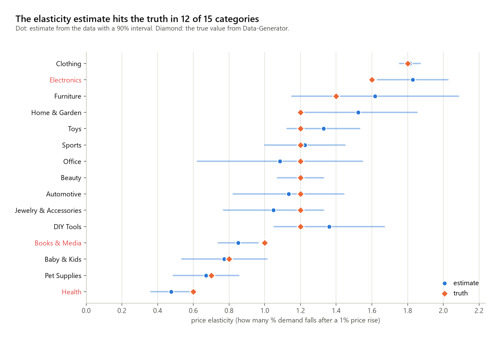
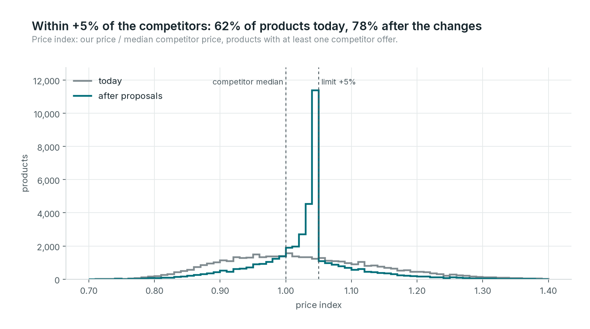
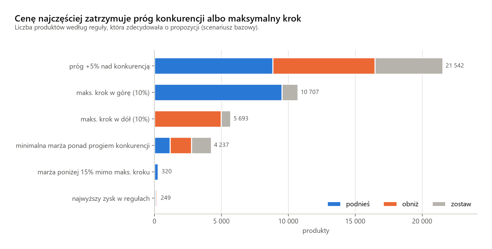
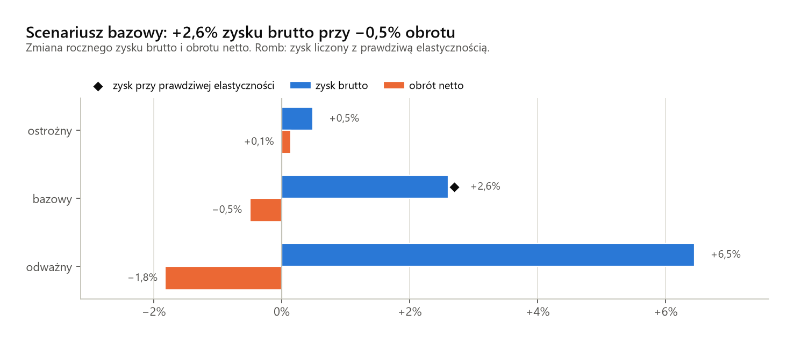
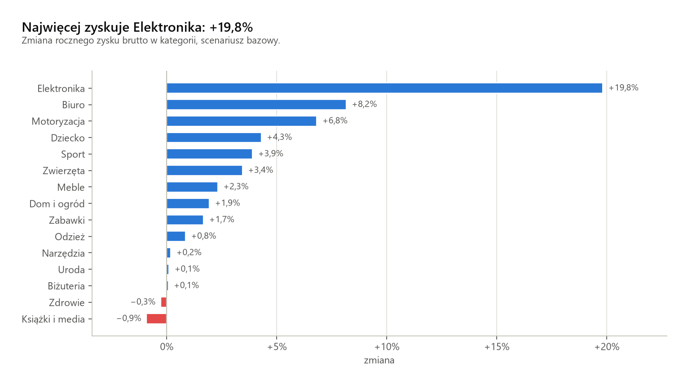
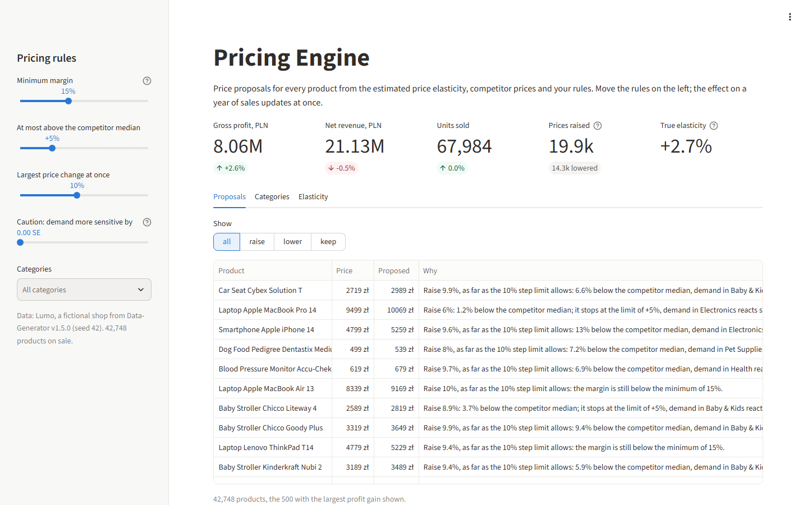
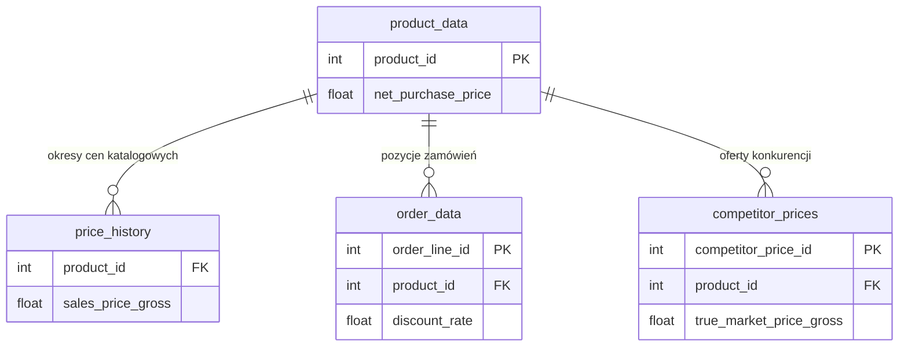

# Pricing Engine

[](https://github.com/tlabedzki/Pricing-Engine/actions/workflows/tests.yml)


[](https://github.com/tlabedzki/Pricing-Engine/releases)
[](README.md)

Silnik propozycji cen dla fikcyjnego sklepu internetowego: nowa cena każdego produktu, powód w jednym zdaniu i szacunek
zysku, sprawdzone z kluczem odpowiedzi.

**Problem.** Sklep sprzedaje dziesiątki tysięcy produktów, a większość cen ustalono raz, narzutem na koszt. Nie
wie, gdzie cena jest za niska i oddaje zysk, a gdzie za wysoka i odsyła klientów do konkurencji. Obniżka „na wszelki
wypadek” zjada marżę, a podwyżka bez rachunku może zjeść sprzedaż.

**Podejście.** Z historii cen i sprzedaży projekt szacuje, jak mocno popyt reaguje na cenę w każdej kategorii. Tę
reakcję mierzy elastyczność cenowa (price elasticity), czyli o ile procent spada sprzedaż, gdy cena rośnie o 1%.
Potem w granicach reguł (minimalna marża, próg ponad cenami konkurencji, największa jednorazowa zmiana) silnik wybiera
cenę o najwyższym oczekiwanym zysku. Dane mają klucz odpowiedzi, więc wynik da się sprawdzić.

<!-- generated:result -->
**Wynik.** Silnik sprawdza ceny 42 748 produktów i zmienia 34 141 z nich; w scenariuszu bazowym roczny zysk brutto
rośnie o +3,0% przy −0,6% obrotu. Przeliczenie tych samych cen z prawdziwą elastycznością daje +3,1%, a szacunek
elastyczności trafia w prawdę w 12 z 15 kategorii.
<!-- /generated:result -->

<!-- generated:hero -->
<picture>
  <source media="(prefers-color-scheme: dark)" srcset="docs/img/app-demo-dark.svg">
  
</picture>
<!-- /generated:hero -->

**Stack:** Python · pandas · DuckDB · SQL · SciPy · Dash · Mantine · Plotly · matplotlib · pytest

<!-- generated:summary -->
- **Trafione:** zysk przewidziany z danych (+3,0%) różni się od zysku przy prawdziwej elastyczności (+3,1%) o 0,1 pkt
  proc.; rabaty i zmiany cen razem dają średni błąd elastyczności 0,12.
- **Chybione:** w 3 kategoriach prawda leży poza przedziałem szacunku: Zdrowie (0,47 zamiast 0,60), Książki i media
  (0,85 zamiast 1,00), Elektronika (1,83 zamiast 1,60); 22% produktów zostaje ponad progiem konkurencji, bo jeden krok
  to za mało albo nie pozwala na to minimalna marża.
<!-- /generated:summary -->

## 1. Sklep Lumo i jego ceny

Lumo to fikcyjny polski sklep internetowy z 15 kategoriami, od odzieży po meble. Ma dwa lata zamówień, historię cen
katalogowych i ceny pięciu fikcyjnych konkurentów. Kierownik kategorii chce wiedzieć, które ceny zmienić, o ile i co
stanie się potem.

| Pytanie | Jak odpowiada analiza | Gdzie leży prawdziwa odpowiedź |
|---|---|---|
| Jak mocno popyt reaguje na cenę w każdej kategorii? | Elastyczność ze zmian cen katalogowych i z rabatów, na tabelach `price_history` i `order_data` (rozdział 3) | `category_price_elasticity` w ustawieniach generatora |
| Gdzie nasza cena odstaje od konkurencji? | Indeks ceny z `competitor_prices` (rozdział 4) | `true_market_price_gross`, `true_price_level` |
| Jaką cenę powinien dostać każdy produkt? | Silnik reguł z rachunkiem zysku (rozdział 4) | zysk tych samych cen przy prawdziwej elastyczności (rozdział 5) |
| O ile rośnie zysk i ile obrotu tracimy? | Rok sprzedaży przeliczony w trzech scenariuszach (rozdział 5) | jak wyżej |
| Na ile można ufać wynikowi? | Przedział z losowania elastyczności (rozdział 5) | przedział zestawiony z prawdą (rozdział 7) |

## 2. Skąd wiadomo, co jest prawdą

Dane pochodzą z [Data-Generator](https://github.com/tlabedzki/Data-Generator) v1.7.1 (ziarno losowania, czyli seed,
42), który ustala, jak klienci reagują na cenę. Te ustawienia są kluczem odpowiedzi:

- `category_price_elasticity`: elastyczność cenowa w kategorii, czyli o ile procent spada sprzedaż po podwyżce o 1%
  (1,8 w odzieży, 0,6 w zdrowiu, 1,2 wszędzie tam, gdzie nie ustawiono innej wartości);
- `true_market_price_gross`: cena rynkowa produktu, od której konkurenci liczą swoje ceny;
- `true_price_level`: poziom cen konkurenta względem rynku (dyskont 0,92, sklep premium 1,08).

Silnik nigdy ich nie czyta. Elastyczność szacuje z tego, co widzi prawdziwy sklep: z zamówień, historii cen i cen
konkurencji. Klucz otwiera dopiero ocena: porównuje szacunek z prawdą i przelicza zysk tych samych propozycji przy
prawdziwej elastyczności. Prawdziwy sklep nie może zrobić takiej kontroli, bo nie zna swojej elastyczności.

W generatorze ceny konkurencji nie wpływają na popyt. Próg ponad cenami konkurencji jest więc regułą biznesową, a nie
wynikiem z danych (więcej w rozdziale 8).

## 3. Jak mocno popyt reaguje na cenę?

**Pytanie.** O ile spada sprzedaż kategorii, gdy cena rośnie o 1%?

**Co robi analiza.** O elastyczności mówią w danych dwa sygnały. Pierwszy to zmiany cen katalogowych: po podwyżce
produkt dostaje mniejszy udział w zamówieniach swojej kategorii. Model porównuje okresy cenowe tego samego produktu,
dzięki czemu popularność produktu nie zmienia wyniku. To warunkowy model Poissona (conditional Poisson model), czyli
model liczby zamówień liczony osobno w obrębie każdego produktu. Każdy okres waży tyle, ile ruch w kategorii w jego
dniach (zapytanie SQL w DuckDB). Drugi sygnał to rabaty: pozycja zamówienia z rabatem ma więcej sztuk. Oba szacunki są
uśredniane z wagą według ich dokładności. Kategorie z małą sprzedażą są przyciągane do średniej wszystkich kategorii; ta
metoda to empiryczny Bayes (empirical Bayes), w którym im mniej danych ma kategoria, tym bliżej średniej ląduje jej
wynik.

**Jak to sprawdzamy.** Każdy szacunek ma przedział 90%, czyli zakres, który powinien zawierać prawdę 9 razy na 10.
Trafienie to prawda wewnątrz przedziału.

**Wynik.**

<!-- generated:elasticity -->
Sam sygnał ze zmian cen katalogowych myli się średnio o 0,45, sam sygnał z rabatów o 0,13, a połączenie z przyciąganiem
do średniej o 0,12. Prawdziwa wartość leży w 90-procentowym przedziale w 12 z 15 kategorii.



Kategorie, w których prawda wypada poza przedziałem, są zaznaczone na miedziano: Zdrowie (0,47 zamiast 0,60), Książki i
media (0,85 zamiast 1,00), Elektronika (1,83 zamiast 1,60).
<!-- /generated:elasticity -->

**Co to znaczy dla sklepu.** Sama historia cen nie wystarczy: ceny zmieniają się rzadko, a większość produktów
sprzedaje się kilka razy w roku. Rabaty dają dużo silniejszy sygnał, więc silnik opiera się głównie na nich.

## 4. Jaką cenę powinien dostać każdy produkt?

**Pytanie.** Przy jakiej cenie sklep zarabia więcej i nie odjeżdża od konkurencji?

**Co robi analiza.** Indeks ceny (price index) mierzy pozycję produktu na rynku: nasza cena podzielona przez medianę cen
konkurencji, czyli środkową z ich cen (1,05 znaczy, że jesteśmy o 5% drożsi). Kilkudniowa promocja konkurenta liczy się
według ceny sprzed promocji. Dla każdego produktu w sprzedaży silnik próbuje cen kończących się na 9 w granicach ±30% od
dzisiejszej. Odrzuca te, które łamią reguły: marża netto co najmniej 15% po średnim rabacie, najwyżej 5% ponad medianą
cen konkurencji i najwyżej 10% zmiany naraz. Z pozostałych wybiera cenę o najwyższym oczekiwanym zysku brutto (gross
profit), czyli sprzedaży bez VAT pomniejszonej o koszt zakupu towaru. Popyt przy nowej cenie liczy z elastyczności
kategorii. Każda propozycja zapisuje regułę, która zatrzymała cenę, oraz powód, na przykład „Podnieś o 9,6%, na ile
pozwala limit kroku 10%: 13% poniżej mediany konkurencji, popyt w Elektronice silnie reaguje na cenę (elastyczność
1,8)”.

**Jak to sprawdzamy.** Testy pilnują, żeby żadna propozycja nie łamała reguł. Jedyny wyjątek to konflikt: gdy
minimalna marża wymaga ceny ponad progiem konkurencji, wygrywa marża, a powód o tym mówi.

**Wynik.**

<!-- generated:proposals -->
Na 42 748 produktów w sprzedaży silnik podnosi 20 765 cen, obniża 13 376 i zostawia 8 607. W progu +5% nad medianą
konkurencji mieści się dziś 62% produktów z ofertą konkurencji, po zmianach 78%.



O 40 014 propozycjach (94%) decyduje próg konkurencji albo maksymalny krok, o 2 241 konflikt marży z rynkiem, a tylko o
493 sam rachunek zysku.


<!-- /generated:proposals -->

**Co to znaczy dla sklepu.** Przy elastycznościach Lumo (od 0,5 do 1,8) najbardziej opłacalna cena jest zwykle wyższa
od dzisiejszej, więc o tym, jak daleko pójść, decydują reguły. Niektóre produkty są tak daleko od rynku, że dojście do
progu wymaga kilku rund zmian.

## 5. Co to zmienia w rocznej sprzedaży?

**Pytanie.** Jak zmieniają się roczny zysk brutto, obrót netto (net revenue, czyli sprzedaż bez VAT) i liczba
sprzedanych sztuk?

**Co robi analiza.** Punktem wyjścia jest sprzedaż każdego produktu w ostatnich 12 miesiącach. Do produktu, który
sprzedał się tylko kilka razy, silnik domieszuje średnią jego kategorii. Potem przelicza sprzedaż po nowych cenach
w trzech scenariuszach reguł. Ostrożny zakłada popyt czulszy na cenę: elastyczność podniesioną o 1,64 błędu
standardowego (standard error, SE), czyli miary niepewności szacunku. To górny koniec przedziału 90%. Na koniec silnik
losuje elastyczność z jej przedziałów 1 000 razy, żeby pokazać, jak niepewny jest wynik.

**Jak to sprawdzamy.** Przeliczamy te same propozycje z prawdziwą elastycznością z Data-Generatora i porównujemy zysk.

**Wynik.**

<!-- generated:scenarios -->
| Scenariusz | Reguły | Zysk brutto | Obrót netto | Sztuki | Podwyżki / obniżki |
|---|---|---|---|---|---|
| ostrożny | do mediany konkurencji, krok 5%, popyt czulszy o 1,64 błędu | +0,6% | +0,1% | +0,6% | 13 363 / 15 542 |
| bazowy | +5% nad medianą, krok 10% | +3,0% | −0,6% | −0,4% | 20 765 / 13 376 |
| odważny | +10% nad medianą, krok 15% | +7,0% | −2,0% | −3,3% | 26 728 / 9 826 |



Przy losowaniu elastyczności z jej przedziałów zmiana zysku w scenariuszu bazowym mieści się w 90% przypadków między
+2,9% a +3,1%. Najwięcej zyskuje Elektronika, żadna kategoria nie traci.


<!-- /generated:scenarios -->

**Co to znaczy dla sklepu.** Scenariusz bazowy podnosi zysk prawie bez utraty sprzedaży. Odważny daje większy zysk, ale
kosztem obrotu i cen wyraźnie wyższych od konkurencji. Najwięcej zyskują kategorie o niskiej marży, takie jak
elektronika: tam każda złotówka podwyżki to duża część marży. Kategorie tracą tam, gdzie obniżki do progu konkurencji
kosztują więcej, niż przynosi dodatkowa sprzedaż.

## 6. Aplikacja: reguły na suwakach

Aplikacja (Dash i Mantine, w tym samym wyglądzie co Data-Generator) pokazuje silnik w działaniu (animacja na górze
strony). Sekcja 01 ma suwaki reguł: minimalna marża, próg ponad medianą konkurencji, największy krok i ostrożność, czyli
liczba błędów standardowych dodanych do elastyczności (jak w scenariuszu ostrożnym), do tego filtr kategorii. Każda
zmiana przelicza w sekcji 02 roczny zysk, obrót, sztuki i zysk przy prawdziwej elastyczności. Zakładka „Proposals”
pokazuje propozycje z powodami i pobieranie pliku CSV, „Categories” zmianę zysku w każdej kategorii i reguły, które
zdecydowały, a „Elasticity” zestawia szacunek z prawdą. Adres strony zapamiętuje reguły, więc `/?above=10&step=15`
otwiera aplikację z progiem +10% i największym krokiem 15%.



## 7. Analiza kontra prawda

<!-- generated:verdicts -->
Elastyczność trafia w prawdę w 12 z 15 kategorii, a zysk scenariusza bazowego przewidziany z danych (+3,0%) zgadza się z
zyskiem przy prawdziwej elastyczności (+3,1%).

| Pytanie | Odpowiedź z danych | Prawda | Ocena |
|---|---|---|---|
| Elastyczność: Zdrowie | 0,47 [0,36; 0,59] | 0,60 | chybione |
| Elastyczność: Książki i media | 0,85 [0,74; 0,96] | 1,00 | chybione |
| Elastyczność: Elektronika | 1,83 [1,63; 2,03] | 1,60 | chybione |
| Elastyczność: Odzież | 1,81 [1,76; 1,87] | 1,80 | trafione |
| Elastyczność: Uroda | 1,20 [1,07; 1,33] | 1,20 | trafione |
| Pozostałe 10 kategorii | w przedziale | zob. wykres w rozdziale 3 | trafione |
| Zmiana zysku, scenariusz bazowy | +3,0% [+2,9%; +3,1%] | +3,1% | chybione, poza przedziałem |
| Zmiana obrotu, scenariusz bazowy | −0,6% | −0,4% | różnica 0,2 pkt proc. |
<!-- /generated:verdicts -->

**Gdzie metody się pomyliły i czego to uczy.**

- **Zdrowie oraz Książki i media: sygnał z cen katalogowych zaniża elastyczność.** Sam ten sygnał stawia Zdrowie blisko
  zera. Model upraszcza generator: waży ruch w kategorii popularnością produktu, a generator wybiera produkty także
  według marki i poziomu cen, jaki preferuje klient. Lekcja: jeden sygnał może być obciążony, czyli systematycznie
  przesunięty w jedną stronę, więc warto mieć dwa niezależne.
- **Elektronika: szacunek jest za wysoki.** Kategoria ma mało zamówień na produkt, a przyciąganie do średniej nie
  wystarczyło. Silnik jest więc ostrożniejszy z podwyżkami w elektronice, niż trzeba.
- **Przedział zysku jest za wąski.** Losowanie elastyczności obejmuje tylko przypadkowy błąd szacunku, a nie jego
  obciążenie w trzech kategoriach. Dlatego prawda wypada tuż poza przedziałem. Lekcja: przedział z modelu to dolna
  granica niepewności, a nie cała niepewność.

Pomyłki zostają w tabeli celowo: ocena, która potrafi powiedzieć „chybione”, sprawia, że każde „trafione” coś znaczy.
W prawdziwym sklepie nikt by tych pomyłek nie zobaczył, bo nie ma klucza odpowiedzi.

## 8. Wnioski dla sklepu i ograniczenia

**Rekomendacje.**

1. Wdrożyć scenariusz bazowy: zysk rośnie przy prawie tym samym obrocie, a prawdziwa elastyczność potwierdza rachunek.
2. Zmieniać ceny w rundach. Po jednej rundzie część produktów zostaje ponad progiem konkurencji, bo dojście do niego
   wymaga kilku kroków.
3. Szacować elastyczność z rabatów i zmian cen katalogowych razem. Sam sygnał z cen katalogowych myli się kilka razy
   mocniej.
4. Tam, gdzie minimalna marża wymaga ceny ponad rynkiem, sprawdzić koszt zakupu albo ofertę. Silnik nie dojdzie tam do
   progu konkurencji.

**Ograniczenia.**

- Dane są syntetyczne, z jedną elastycznością na kategorię, stałą w czasie. W prawdziwym sklepie różni się ona między
  produktami i sezonami, a rabat może działać inaczej niż zmiana ceny katalogowej.
- W generatorze ceny konkurencji nie wpływają na popyt, więc model nie widzi kosztu ceny ponad rynkiem. Chroni przed
  nim reguła progu konkurencji. W prawdziwym sklepie warto ją zastąpić szacunkiem z danych o udziale w rynku.
- Jedno ziarno losowania i prognoza na rok. Wynik pomija reakcje konkurentów na nasze zmiany oraz zwroty.
- Bez klucza odpowiedzi elastyczność sprawdza test A/B cen na części produktów, czyli porównanie produktów z nową ceną
  z produktami, których cena się nie zmienia.

## Szybki start

Potrzebujesz Gita i Pythona 3.11. Sklonuj repozytorium:

```bash
git clone https://github.com/tlabedzki/Pricing-Engine.git
cd Pricing-Engine
```

<details><summary>Utwórz i włącz środowisko wirtualne z Pythonem 3.11 (Windows, macOS i Linux)</summary>

Podanie wersji wybiera Pythona 3.11 nawet wtedy, gdy domyślnie ustawiony jest inny.

| Krok | Windows (PowerShell) | macOS i Linux |
|---|---|---|
| Utwórz | `py -3.11 -m venv .venv` | `python3.11 -m venv .venv` |
| Włącz | `.venv\Scripts\Activate.ps1` | `source .venv/bin/activate` |
| Sprawdź | `python --version` wypisuje `Python 3.11.x` | `python --version` wypisuje `Python 3.11.x` |

Jeśli PowerShell zgłasza, że uruchamianie skryptów jest wyłączone, uruchom raz
`Set-ExecutionPolicy -Scope CurrentUser RemoteSigned` i włącz środowisko ponownie.

</details>

Potem zainstaluj pakiety, pobierz dane i uruchom silnik:

```bash
pip install -r requirements.txt
python scripts/get_data.py
python main.py
```

`get_data.py` klonuje Data-Generator v1.7.1 i generuje dane sklepu (około 15 s). `main.py` wypisuje elastyczność,
przykładowe propozycje i scenariusze, a pliki CSV i `summary.json` zapisuje w `output/` (około 15 s).

### Wiersz poleceń

`python main.py propose --min-margin 0.2 --max-above-market 0 --max-step 0.05` liczy propozycje z Twoimi regułami.
`python main.py elasticity` pokazuje szacunek elastyczności obok prawdy.

### Aplikacja

`python -m ui.app` uruchamia aplikację; otwórz http://127.0.0.1:8050 w przeglądarce (działa tylko na tym komputerze).
Pierwsze otwarcie trwa kilka sekund, bo silnik szacuje wtedy elastyczność; Ctrl+C w terminalu zatrzymuje aplikację.

## Dane

Dane są syntetyczne: [Data-Generator](https://github.com/tlabedzki/Data-Generator) v1.7.1 (licencja MIT), ziarno
losowania 42, generowane przez `scripts/get_data.py` do `data/raw/` (poza gitem). Silnik czyta cztery z 15 jego tabel.
Marki produktów są prawdziwe, ale produkty, ceny, marże i sprzedaż są fikcyjne i nic nie mówią o tych markach. Sklepy
konkurencji (Frugalia, Aequo, Maison Orvelle, Mercatoria, Fulmina) są fikcyjne.



Opisy kolumn:
[docs/columns.md w Data-Generatorze](https://github.com/tlabedzki/Data-Generator/blob/v1.7.1/docs/columns.md).
Prawdziwa elastyczność trafia do `data/raw/truth.json` prosto z ustawień generatora.

## Dlaczego te technologie

Każde narzędzie wybrano pod sposób, w jaki projekt czyta dane: jedno uruchomienie czyta cztery wygenerowane tabele
z lokalnych plików Parquet (kolumnowy format plików z danymi), raz szacuje elastyczność każdej kategorii, a potem przy
każdej zmianie reguły liczy od nowa cenę każdego produktu. Świeży klon odtwarza wszystko dwoma poleceniami, bez
serwera, konta, klucza i płatnej usługi.

| Narzędzie | Co robi w projekcie i dlaczego pasuje | Rozważona alternatywa |
|---|---|---|
| Data Generator | Generuje fikcyjny sklep i zna prawdziwą elastyczność każdej kategorii, więc szacunek jest z nią porównywany; od v1.5.0 generuje też ceny konkurencji. | Ceny konkurencji zrobione przez sam projekt utrzymałyby jego samodzielność, ale trafiły do Data Generatora, więc konkurenci pochodzą z tego samego generatora co sklep. |
| pandas, numpy i pyarrow | Czytają z tabel Parquet tylko potrzebne kolumny i uruchamiają silnik oraz symulację; wersje zgadzają się z Data Generatorem, który działa w środowisku tego projektu. | – |
| DuckDB | Wykonuje jedyne zapytanie SQL (`sql/price_periods.sql`), które zamienia pozycje zamówień i historię cen katalogowych na pozycje i ekspozycję (exposure), czyli ruch w kategorii zsumowany po dniach okresu, w każdym okresie cenowym, wprost na ramkach pandas i bez serwera. | – |
| SciPy | Dopasowuje elastyczność metodą największej wiarygodności (maximum likelihood) zapisaną w projekcie: model Poissona w obrębie każdego produktu, więc popularność produktu się znosi, oraz regresja Poissona liczby sztuk względem rabatu. | – |
| matplotlib | Rysuje wykresy README w kolorach i czcionce Inter aplikacji, na białym tle, więc wyglądają tak samo w jasnym i ciemnym motywie GitHuba, a dwa uruchomienia dają te same bajty. | – |
| Dash, Mantine i Plotly | Aplikacja z suwakami reguł i jej wykresy, zbudowane z tych samych klocków co każda aplikacja w tym portfolio; test sprawdza, że jej główne liczby są liczbami silnika. | Streamlit, aplikacja w wersji 1.0.0: zastąpiony, żeby portfolio miało jeden wygląd; stylowanie Streamlita pod ten wygląd dało kolory i czcionkę, ale nie układ. |
| pytest | Testuje estymatory na danych o znanej elastyczności, a reguły na losowych produktach; tabela konkurencji zrobiona przez projekt pozwala uruchomić CI (automatyczne testy na GitHubie) bez wygenerowanych danych. | – |

## Struktura projektu

<details><summary>Pokaż drzewo</summary>

```
main.py                         wiersz poleceń: elastyczność, propozycje, scenariusze
src/pricing_engine/
  data.py                       wczytuje tabele Data-Generatora
  sql/price_periods.sql         zapytanie DuckDB: pozycje zamówień i ekspozycja w każdym okresie ceny katalogowej
  elasticity.py                 elastyczność z cen katalogowych i rabatów, połączona i przyciągnięta do średniej
  engine.py                     reguły, najbardziej zyskowne ceny kończące się na 9, powody
  simulate.py                   scenariusze, niepewność, kontrola z prawdziwą elastycznością
  report.py                     pięć głównych liczb pokazywanych w aplikacji i w animacji
  theme.py                      kolory i czcionka wyglądu portfolio, wspólne dla aplikacji i wykresów
  mock_competitors.py           tabela konkurencji dla testów i dla wydań sprzed v1.5.0
ui/app.py                       aplikacja: układ i callbacki (Dash, Mantine)
ui/figures.py                   wykresy Plotly aplikacji
ui/assets/                      arkusz stylów, pliki czcionki Inter (SIL Open Font License), wartości suwaków na żywo
notebooks/01-pricing-engine.ipynb   cały projekt krok po kroku
scripts/get_data.py             klonuje i uruchamia Data-Generator
scripts/make_charts.py          wykresy i liczby README (readme_blocks.py)
scripts/make_demo_svg.py        animowane demo aplikacji na górze (wywołuje je make_charts.py)
scripts/screenshot_app.py       zrzut ekranu aplikacji do README
scripts/inter_font.py           Inter do wykresów README i dema, z cyframi o stałej szerokości
tests/                          pytest
```

</details>

## Testy

```bash
pip install -r requirements-dev.txt
python -m pytest
```

68 testów (około 15 s) sprawdza estymatory na danych o znanej elastyczności, reguły silnika na losowych produktach,
symulację, tabelę konkurencji, wiersz poleceń i aplikację. Test aplikacji potrzebuje danych z `get_data.py`; bez nich
jest pomijany, tak jak w CI.

## Licencja

MIT, zob. [LICENSE](LICENSE). Krój Inter w `ui/assets/fonts/` jest na licencji SIL Open Font License 1.1
([OFL-inter.txt](ui/assets/fonts/OFL-inter.txt)). [Changelog](CHANGELOG.md).

Ostatnia aktualizacja README: 2026-11-27
